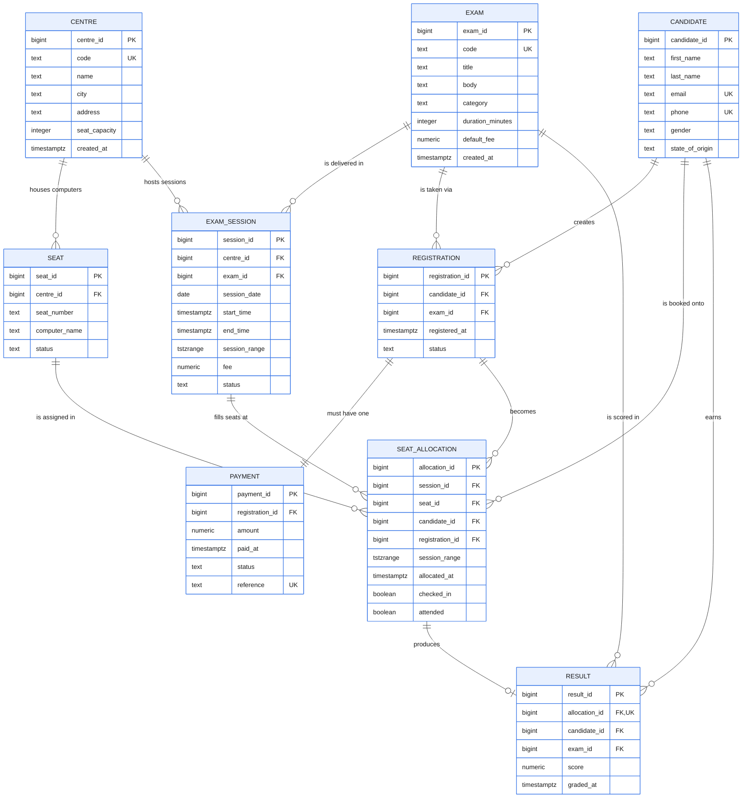

# Portfolio 1 — Database Design and Modelling

**Portfolio:** 1 · **Marks:** 7 · **Study session covered:** Study Session 1
(*Review of Traditional Relational Databases and Advanced Concepts*:
normalisation, database design stages, keys, constraints, characteristics of
a good database).

## ER diagram

(GitHub draws this automatically; source: `er_diagram.mmd`.)



## What this portfolio demonstrates

A complete relational design for the TestPoint CBT case study:

1. **ER diagram** (Mermaid) — `er_diagram.mmd`. Render it with
   `mmdc -i er_diagram.mmd -o er_diagram.png` or paste it into
   <https://mermaid.live>.
2. **Relational schema** — 9 tables in 3NF: `centre`, `exam`,
   `exam_session`, `seat`, `candidate`, `registration`, `seat_allocation`,
   `payment`, `result`. See `schema/02_tables.sql`.
3. **Advanced constraints** (in `schema/03_constraints.sql`):
   - `UNIQUE (candidate_id, session_id)` — one seat per candidate per session.
   - `UNIQUE (seat_id, session_id)` — no seat to two candidates in a session.
   - `EXCLUDE USING gist (candidate_id WITH =, session_range WITH &&)` — a
     candidate cannot be in two overlapping sessions (requires `btree_gist`).
   - `CHECK (amount > 0)` on `payment`.
   - `CHECK (score BETWEEN 0 AND 100)` on `result`.
4. **Trigger** (in `schema/04_triggers.sql`):
   - `trg_check_session_capacity` — a session cannot exceed its centre's
     `seat_capacity` (CBT-specific capacity rule).
   - `trg_sync_session_range` — keeps `seat_allocation.session_range` in sync
     with the parent `exam_session` so the EXCLUDE constraint has the right
     value.
5. **Seed data** (`schema/05_seed.sql`) — small, readable: 5 centres, 9
   exams, ~450 seats, 8 candidates, 5 sessions, 7 allocations, payments and
   results.
6. **Bulk generator** (`bulk_data/generate_bulk.py`) — produces
   **50,000+ seat allocations over a 2-year window** with realistic Nigerian
   names, dates and fees, all constraint-compliant.
7. **Constraint tests** (`tests/constraint_tests.sql`) — 6 statements that
   MUST fail (one per constraint), each wrapped in a DO block that prints
   `PASS Tn` when the violation is correctly rejected.
8. **3NF notes** (`docs/normalisation.md`) — table-by-table walk through
   1NF → 2NF → 3NF, including documented deliberate denormalisations.

## How to run (Codespaces)

```bash
bash setup.sh                       # once, installs PostgreSQL 16 + MongoDB 8
bash portfolio-1-database-design/run_p1.sh
```

The script:

1. Drops + recreates the `testpoint` database.
2. Applies `01_extensions.sql` → `02_tables.sql` → `03_constraints.sql` →
   `04_triggers.sql` → `05_seed.sql`.
3. Prints the post-seed row counts.
4. Runs `tests/constraint_tests.sql` and prints `PASS T1` … `PASS T6b`.
5. Runs `bulk_data/generate_bulk.py` to insert 50k+ allocations.
6. Prints the final row counts.

## What to screenshot (for the LMS evidence)

| Screenshot | Where it comes from |
|---|---|
| ER diagram (rendered) | `mmdc -i er_diagram.mmd -o er_diagram.png` or mermaid.live |
| Post-seed row counts | The table printed by `run_p1.sh` |
| Constraint tests output | The `PASS T1` … `PASS T6b` lines from `run_p1.sh` |
| Bulk data summary | The `BULK DATA SUMMARY` block printed by `generate_bulk.py` |
| Final row counts | The table printed at the end of `run_p1.sh` |

## Git commit (from repo root)

```bash
git add portfolio-1-database-design/ && \
git commit -m "feat(p1): schema, 3NF notes, ER diagram, 50k+ bulk data, constraint tests" && \
git tag p1-design
```

## Plain-English explanation

This portfolio answers the question **"can you design a correct relational
schema for a realistic Nigerian business?"** The business is TestPoint CBT,
which books candidates onto computer seats in exam sessions across five
cities. The hard parts are not the obvious `centre / exam / candidate`
tables — they are the **integrity rules** that stop the business from
physically impossible states:

- A candidate cannot be on two seats at once (UNIQUE on
  candidate+session).
- A computer cannot host two candidates at once (UNIQUE on seat+session).
- A candidate cannot be in two sessions whose times overlap (EXCLUDE on a
  tstzrange, which needs the `btree_gist` extension).
- A session cannot over-fill a centre (a trigger that counts existing
  allocations against the centre's `seat_capacity`).
- Money and scores must be sane (CHECK constraints).

The bulk generator then proves the schema actually scales: it loads ~55,000
constraint-compliant seat allocations across a 2-year window using realistic
Nigerian names, dates and fees, which gives Portfolio 2 enough data to make
EXPLAIN ANALYZE meaningful.

This portfolio maps directly to **Study Session 1** of the MIT 8103 course
notes, which covers database design stages, normalisation, keys,
constraints, and the characteristics of a good database.
